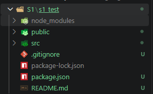

## V009 Hello World React

Dentro da pasta que vc se encontra abrir o powershell  e:

```
npx create-react-app <name_of_project>
```

Para inicializar

```
cd <name_of_project>
npm start
```



- src: codigo principal
  - App.js: Tem a aplicação. Utiliza tags similares ao html.

``` js
import logo from './logo.svg';
import './App.css';

function App() {
  return (
    <div className="App">
      <h1>Hello, Rufo!</h1>
    </div>
  );
}

export default App;
```

## V010 Criação com Vite

``` bash
npm create vite@latest 
# Select React
# Select js
# Follow instructions
```

Depois roda utilizando:
``` bash
#Dentro da pasta de projeto
npm run dev
```

## V011 Estrutura base

- `node_modules`: dependencias aqui.
- `public`: Assets estáticos e HTML de inicialização
- `src`: codigo fonte
- `src/index.js`: Arquivo de inicialização do React
- `src/App.js`: Componente principal da applicação

## V012 Extensao

Instalar extensao `ES7+React/Redux/React-Native` snippets

## V013 Emmet

1. File > Settings
2. Item: `javascript` e value: `javascriptreact`