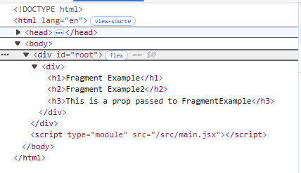
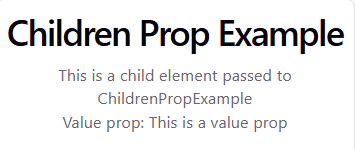
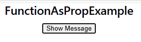
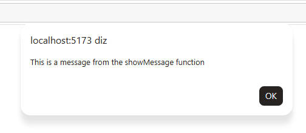

## V035 Imagenes publicas no React

- Ficam na pasta `public`
- Tag `img` e com o `/path.jpg`  

``` jsx
function App() {  
  return (
    <div>
      <h1>S3 More content!</h1>
      
    </div>
  )
}

export default App
```

## V036 Imagens no src
- Pasta public pode ser utilizada para armazenar imagens.
- Mas um boa prática é armazenar na pasta `assets` dentro do `src`
  - Utilizando `assets` precisamos importar as imagens. O `src` é dinamico com o nome da importação.

``` jsx
import "./App.css"
import Hero from "./assets/Hero.png"
function App() {
  

  return (
    <div>
      <h1>S3 More content!</h1>
      {/* Local image from public folder */}
      
      {/* Imported image from assets */}
      
    </div>
  )
}

export default App
```
## V037 Hooks
- São recursos do react para realizar diversas funções
  - Salvar e alterar estado de algum dado na applicação.
- Sintaxis: `useSomething` e.g. `useState`
- Podem ser feitos custom hook, ou seja implementados pela gente.
- precisam ser importados.
- Muito úteis

## V038 useState hook
- Dos mais utilizados
- Serve para gerenciar o estado de algum dato. (Se a variavel nao funciona corretamente, o componente nao é re-renderiza)
- Como utilizar?
  - Para guardar o dado definimos o nome da variável 
  - para alterar utilizamos `setName` 

``` jsx
import { useState } from "react";

const ManageData = () => {
    let someValue = 73;

    const [anotherValue, setAnotherValue] = useState(0);

  return (
    <div>
        <div>
            Manage Data Component
            <p>Value {someValue}</p>
            {/* Button to change the value of someValue */}
            {/* This will not actually update the displayed value because React does not track changes to regular variables. */}
            <button onClick={() => (someValue = 100)}> Change Value </button>      
        </div>
      
        <div>
            Manage Data Component
            <p>Value {anotherValue}</p>
            {/* Button to change the value of anotherValue */}
            {/* This will update the displayed value because React tracks changes to state variables. */}
            <button onClick={() => setAnotherValue(100)}>Change Value</button>
        </div>
    </div>
  );
};

export default ManageData;
```
- O primeiro botão nao faz nada. Nao atualiza o valor.
- O segundo sim.

## V039 Renderização de listas
- Renderizar listas de dados no template
- Utiliza dados do tipo array
- Muito util é o `map`
- Logicamente vai ter iteração para mostrar os dados.

### Index dummy

``` js
const ListRender = () => {
    const items = ["Item 1", "Item 2", "Item 3"];
  return (
    <div>
        <div>
            <h2>ListRender</h2>
            <ul>
                {items.map((item, index) => (
                <li key={index}>{item}</li>
                ))}
            </ul>
        </div>
    </div>
  )
}

export default ListRender
```
## V040 A propriedade Key
- Iterar uma lista sem a `key` gera um warning.
- React exige uma chave unica para cada um dos itens iterados.
  - Geralmente como temos um array podemos utilizar o index,
  - porém é melhor utilizar um `id`.

``` js 
import { useState } from "react"

const ListRender = () => {
    const items = ["Item 1", "Item 2", "Item 3"];

    const [users] = useState([
        { id: 111, name: "User 1", age: 25 },
        { id: 222, name: "User 2", age: 30 },
        { id: 333, name: "User 3", age: 35 }
    ])
  return (
    <div>
        <div>
            <h2>ListRender</h2>
            <ul>
                {items.map((item, index) => (
                <li key={index}>{item}</li>
                ))}
            </ul>
        </div>
        <div>
            <h2>ListRender</h2>
            <ul>
                {users.map((user) => (
                <li key={user.id}>{user.name} - {user.age} years old</li>
                ))}
            </ul>
        </div>
    </div>
  )
}

export default ListRender
```
## V041 Previous state
- Permite pegar o dado em seu valor original dentro de um set de dado.
- Utilizado para modificar listas,
- O primeiro argumento de um set sempre será o previous state.
- `prevUser` na verdade é o estado atual, porém ao chamar na função passa a ser o previo.

``` jsx
import { useState } from "react"

const PrevStateExample = () => {    

    const [users, setUsers] = useState([
        { id: 1, name: "User 1", age: 25 },
        { id: 2, name: "User 2", age: 30 },
        { id: 3, name: "User 3", age: 35 }
    ])

    const deleteRandom = () => {
        const randomIndex = Math.floor(Math.random() * (users.length +1) );
        
        setUsers((prevUsers) => {
            console.log(prevUsers)
            return prevUsers.filter((user) =>  randomIndex !== user.id);
        });
    }
  return (
    <div>        
        <div>
            <h2>PrevStateExample</h2>
            <ul>
                {users.map((user) => (
                <li key={user.id}>{user.name} - {user.age} years old</li>
                ))}
            </ul>
            <button onClick={deleteRandom}>Delete Random User</button>
        </div>
    </div>
  )
}

export default PrevStateExample
```
## V042 Renderização Conditional
- Dada uma condição, se imprimi um UI diferente.
  - Logicamente isso quer fizer `if`
- Isso é importantepara autenticação de usuário.

``` jsx

import { useState } from "react";

const ConditionalRender = () => {
    
    const [value, setValue] = useState(false);

  return (
    <div>
        <div>
            Conditional Render Component
            <p>Value {value.toString()}</p>          
            {/* Conditional rendering example */}
            <button onClick={() => setValue(!value)}> Change Value </button>      
            {value && <p>The value is true!</p>}
            {!value && <p>The value is false!</p>}
        </div>      
        
    </div>
  );
};

export default ConditionalRender;
```
## V043 If e else no JSX
- Podese utilizar if ternario `condition? bloco1 : bloco2`

``` jsx

import { useState } from "react";

const ConditionalTernario = () => {
    
    const [value, setValue] = useState(false);

  return (
    <div>
        <div>
            Conditional Render Component
            <p>Value {value.toString()}</p>          
            {/* Conditional rendering example */}
            <button onClick={() => setValue(!value)}> Change Value </button>      
            {value ? <p>The value is true!</p> : <p>The value is false!</p>}
        </div>      
        
    </div>
  );
};

export default ConditionalTernario;
```

## V044 Introdução as props
- Permite passar valores de um componente pai para um componente filho.
  - Bom para carregar dados da DB
  - As props vem em um objeto no argumento da função do componente.

``` jsx
//Filename: PropsExample.jsx
const PropsExample = ({ name, age }) => {
  return (
    <div>
      <p>Name: {name}</p>
      <p>Age: {age}</p>
    </div>
  );
};

export default PropsExample;

//Filename: App.jsx
import "./App.css"
import PropsExample from "./components/PropsExample"

function App() {
  return (
    <div>
      <PropsExample name="Rufa" age={18} />      
    </div>
  )
}

export default App
```
## V045 Destructuring em props
- Utilizado para passar mais de uma `prop` no componente
-  Para passar `name` e `age` utilizamos `MyComponent({name, age})`
  
### Usando objetos 

``` jsx
// Obj
const DesestructuringPropsExample = ({ train }) => {
  return (
    <div>
      <p>Marca: {train.brand}</p>
      <p>Modelo: {train.model}</p>
      <p>Año: {train.year}</p>      
    </div>
  );
};

export default DesestructuringPropsExample;

// App
<DesestructuringPropsExample train={{ brand: "Siemens", model: "Velaro", year: 2020 }} />
```

### Usando desestructing

``` js
const DesestructuringPropsExample = ({ brand, model, year }) => {
  return (
    <div>
      <p>Marca: {brand}</p>
      <p>Modelo: {model}</p>
      <p>Año: {year}</p>      
    </div>
  );
};

export default DesestructuringPropsExample;
// App
<DesestructuringPropsExample brand="Siemens" model="Velaro" year={2020} />
```

## V046 Reaproveitamento de componentes
- Com `props` a `reutilização de componentes` começa a fazer muito sentido.

``` jsx
import "./App.css"
import DesestructuringPropsExample from "./components/DesestructuringPropsExample"

function App() {

  return (
    <div>      
      <DesestructuringPropsExample brand="Dummy1" model="Model1" year={2020} />
      <DesestructuringPropsExample brand="Dummy2" model="Model2" year={2021} />
      <DesestructuringPropsExample brand="Dummy3" model="Model3" year={2022} />
      <DesestructuringPropsExample brand="Dummy4" model="Model4" year={2023} />
    </div>
  )
}

export default App
```

## V047 Renderização de lista em componente
- Os arrays de dados podem ter muitos itens tmbm
  - Por isso é bom utilizar estrutura de loop `map` para mostrar
- Assim coneguimos:
  - renderização de listas
  - reaproveitamento de componentes
  - reaproveitamento de props

``` jsx
import "./App.css"
import DesestructuringPropsExample from "./components/DesestructuringPropsExample"

function App() {
  
  const cars = [
    { index: 1,brand: "Dummy1", model: "Model1", year: 2020 },
    { index: 2,brand: "Dummy2", model: "Model2", year: 2021 },
    { index: 3, brand: "Dummy3", model: "Model3", year: 2022 },
    { index: 4, brand: "Dummy4", model: "Model4", year: 2023 }
  ];
  return (
    <div>      
      {cars.map((car) => (
        <DesestructuringPropsExample
          key={car.index}
          brand={car.brand}
          model={car.model}
          year={car.year}
        />
      ))}
    </div>
  )
}

export default App
```
## V048 Fragments
- Para quando precisa-se mais de um elemento pai em um componente. i.e. Um nivel de div é removido.
- Cria-se uma tag cazia: `<> ... <>`
  - Isso serve como elemento pai, nao alterando a estrutura do HTML com uma div.

``` jsx
import React from "react"

const FragmentExample = ({propFragment}) => {
  return (
    {/* NAO TEM DIV*/}
    <>
      <h1>Fragment Example</h1>
      <h2>Fragment Example2</h2>
      <h3>{propFragment}</h3>
    </>
  )
}

export default FragmentExample

//Filename: App.jsx
function App() {
 
  return (
    <div> 
      <FragmentExample propFragment="This is a prop passed to FragmentExample" />
    </div>
  )
}
```

- O componente aparece dentro do div do App



## V049 A prop children
- Utilizado quando um componente precisa ter codigo JSX dentro dele
  - Porém esse JSX vem do componente pai.
- O componente age como um container
  - E children é considerada uma prop do componente.

``` jsx
const ChildrenPropExample = ({children, value}) => {
  return (
    <div>
      <h1>Children Prop Example</h1>
      {children}
      <p>Value prop: {value}</p>
    </div>
  )
}

export default ChildrenPropExample

// No App.jsx seria chamado como
// É um componente com código JSX dentro dele.
<ChildrenPropExample value="This is a value prop">
  <p>This is a child element passed to ChildrenPropExample</p>
</ChildrenPropExample> 
```

Tendo como resultado:



## V050 Função como prop
- As funções podem ser passadas para as props normalmente.
  - Ao criar uma função no componente pai e enviar como prop para o componente.
  - No componente filho, a função pode ser chamada por um evento.

``` jsx
const FunctionAsPropExample = ({myFunc}) => {
  return (
    <div>
      <h2>FunctionAsPropExample</h2>
      <button onClick={myFunc}>Show Message</button>
    </div>
  )
}

export default FunctionAsPropExample

// No App.jsx
<FunctionAsPropExample myFunc={showMessage} /> 

```

- UI  
  
- Result  
  

## V051 State lift 


