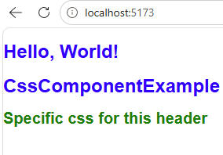
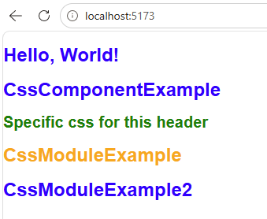

## V056 CSS global
- Arquivo `index.css` localizado na pasta `src`

``` jsx
// Filename: App.jsx
import './App.css'

function App() {
  
  return (
    <div className="App">
      <h1>Hello, World!</h1>
    </div>
  )
}

export default App
```

``` css
// Filename: index.css
body {  
  margin: 0;
  padding: 0;
  font-family: sans-serif;
}

h1{
  color: red;
}
```
## V057 CSS de Componentes
- Geralmente um arquivo com o mesmo nome porem extensão `css`
- RISCO DE VAZAMENTO. Se fazer css para um `<p>` vai aparecer para todos os `<p>`

``` jsx
// File: App.jsx
import './App.css'
import CssComponentExample from './components/CssComponentExample'

function App() {
  
  return (
    <div className="App">
      <h1>Hello, World!</h1>
      <CssComponentExample />
    </div>
  )
}

export default App

// File: CssComponentExample.jsx
import './CssComponentExample.css'
const CssComponentExample = () => {
  return (
    <div>
        <h1>CssComponentExample</h1>
        <h1 className="specific-css"> Specific css for this header</h1>
    </div>
  )
}

export default CssComponentExample
```

``` css
// File: CssComponentExample.css
h1{
    color: blue;
    font-size: 24px;
}

.specific-css{
    color: green;
    font-size: 20px;
}
```

- O css para `h1` polui. Por isso deve criar classes.



## V058 CSS inline


## V059 CSS inline dinamico


## V060 Classes dinamicos

## V061 CSS Modules
- Recurso scoped
- Sintaxis: `<ComponentName.module.css>`

``` css
// File: CssModuleExample.module.css
.css_module_example {
    color: orange;
    font-size: 24px;
}
```

``` jsx
// File: CssModuleExample.jsx
import styles from './CssModuleExample.module.css'

const CssModuleExample = () => {
  return (
    <h1 className={styles['css_module_example']}>CssModuleExample</h1>
  )
}

export default CssModuleExample
```

``` jsx
import './App.css'
import CssComponentExample from './components/CssComponentExample'
import CssModuleExample from './components/CssModuleExample'

function App() {
  
  return (
    <div className="App">
      <h1>Hello, World!</h1>
      <CssComponentExample />
      <CssModuleExample />
      {/*Aqui nao vai a ter css do CssModuleExample*/}
      <h1 className="css_module_example">CssModuleExample2</h1>
    </div>
  )
}

export default App
```


