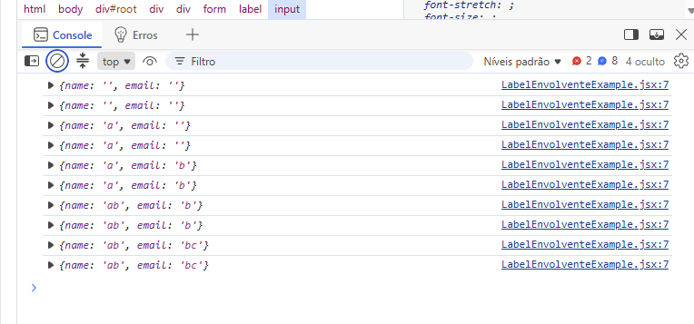
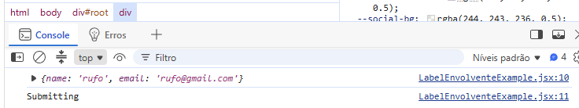

## V064 Criando formulários
- tag `form` para formulários
- As labels dos inputs contém o atributo `htmlFor` que deve ter o valor do name do input.
- NÃO se utiliza action, ate pq o processo vai ser feito de forma assincrona.

``` jsx
// Filename: MyForm.jsx
const MyForm = () => {
  return (
    <div>
        <form>
            <div>
                <label htmlFor="name">Name:</label>
                <input type="text" name="name" placeholder="Digite o seu Nome"/>
            </div>            
            <button type="submit">Submit</button>
        </form>
    </div>
  )
}

export default MyForm

// Filename: MyForm.css
form {
    width: 300px;
    margin: 0 auto;
    text-align: left;
}

input,
textarea,
select {
    display: block;
    margin-top: 10px;
}
```

## V065 Label envolvendo input
- É comum ver o tag `label` envolvendo o input.
- Assim o atributo `for` vira opcional.
  - Isto simplifica a estrutura do html

``` jsx
// Filename: LabelEnvolventeExample.jsx
const LabelEnvolventeExample = () => {
  return (
    <div>
      <form> 
        <label>            
            <span>Some text inside the label</span>
            <input type="text" name="name" placeholder="Digite o seu value da label"/>
        </label>        
        <input type="submit" value="Submit" />
      </form>
    </div>
  )
}

export default LabelEnvolventeExample

// Filename: App.jsx
import './App.css'
import LabelEnvolventeExample from './components/LabelEnvolventeExample'

function App() {

  return (
    <>
      Lobo      
      <LabelEnvolventeExample />
    </>
  )
}

export default App
```

## V066 Gerenciamento de dados de input
- Para manipular os valores dos inputs utilizamos `useState`
  - Armazenar, utilizar e modificar o valor.
- `onChange` event: Função para alterar o valor no evento.

``` jsx
import { useState } from 'react'

const LabelEnvolventeExample = () => {
  const [name, setName] = useState('')
  const [email, setEmail] = useState('')

  const handleSubmit = (e) => {    
    console.log("Form submitted")
  }

  return (
    <div>
      <form> 
        <label>            
            <span>Some text inside the label</span>
            <input type="text" name="name" placeholder="Digite o seu value da label" value={name} onChange={handleSubmit}/>            
        </label>        
        <label>
            <span>Email</span>
            <input type="email" name="email" placeholder="Digite o seu email" value={email} onChange={handleSubmit}/>            
        </label>
        <input type="submit" value="Submit" />
      </form>
    </div>
  )
}

export default LabelEnvolventeExample
```

## V067 Alteração de state inline
- Simplifica manipulação
- Se cria uma função inline no onChange que altera o valor do state com o método set.
  
``` jsx
import { useState } from 'react'

const LabelEnvolventeExample = () => {
  const [name, setName] = useState()
  const [email, setEmail] = useState()

  const handleSubmit = (e) => {
    // Evita re-renderizar depois de clicar no botao, deletando os inputs
    e.preventDefault();
    console.log({ name, email })
    console.log("Submitting")
  }
  
  


  return (
    <div>
      <form onSubmit={handleSubmit}> 
        <label>            
            <span>Some text inside the label</span>            
            <input type="text" name="name" placeholder="Digite o seu value da label" value={name} onChange={(e) => setName(e.target.value)}/>
        </label>        
        <label>
            <span>Email</span>            
            <input type="email" name="email" placeholder="Digite o seu email" value={email} onChange={(e) => setEmail(e.target.value)}/>
        </label>
        <input type="submit" value="Submit" />
      </form>
    </div>
  )
}

export default LabelEnvolventeExample
```
- Output: 


## V068 Envio de form
- evento `onSubmit`
  - Chama uma função, e nesta devemos lembrar de parar a submissção com o `preventDefault`
  - Podemos realizar validaciones, envio de form para o server, reset do form etc.



## V069 Controlled inputs

## V070 Resetando formulários

## V071 Textarea no React

## V072 Select no React