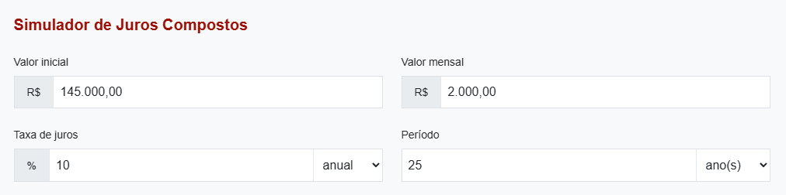
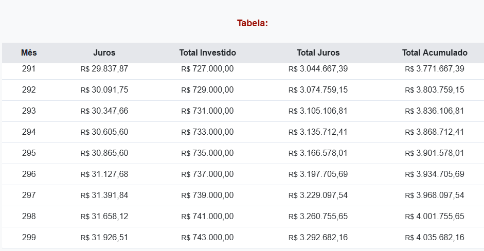

- [Finanzas Personales](#finanzas-personales)
- [Como usar la tarjeta de crédito](#como-usar-la-tarjeta-de-crédito)
- [Como resolver deudas](#como-resolver-deudas)
  - [Deudas que caducan](#deudas-que-caducan)
  - [Como resolver?](#como-resolver)
- [Financiamento de casa](#financiamento-de-casa)
  - [Financieramente Alugar vs Financiar.](#financieramente-alugar-vs-financiar)
  - [Comprar casa a vista](#comprar-casa-a-vista)
  - [Compensa antecipar financieramente?](#compensa-antecipar-financieramente)
- [Consorcios a.k.a Pandero](#consorcios-aka-pandero)
- [Vivier de renta y primer millón](#vivier-de-renta-y-primer-millón)
- [Test](#test)

## Finanzas Personales

- Entra en [link](https://ferramentas.auvp.com.br/home)
- Entra en orçamento doméstico.
  1. Cuanto ganaste en este més? Esto es el `orçamento doméstico` (incluye el salario de la esposa no se incluye renta de los hijos).
  2. Definir porcentajes de metas 
     1. Maxímo de 30% en costos fijos e.g: alquiler, condominio, cuota del carro. Todo lo que uno no puede dejar de pagar.
        1. Si es más de 40% la libertad financiera está en riesgo crítico. Además que el riesgo de ser endeudado aumenta (si te despiden el 40% mes a mes de va a ahorcar).
     2. Conforto 15%: Diarista, van, todo o que melhora seu conforto de vida.
     3. Metas 15%: Viagem familiar anual, ferias da familia, presentes de natal. 
        1. No tener metas hacen que uno se organize peor. 
        2. Se puede intercambiar entre metas y placeres.
     4. Prazer 10%: Cerveja, cinema, motel, churrasco.
     5. Libertad financiera 25%:
     6. Conhecimento 5%: Toda inversión orientada a ganar más dinero.

## Como usar la tarjeta de crédito

## Como resolver deudas
- la naturaleza de la deuda importa bastante. 
  - Deudas a largo plazo son menos peligrosas. Se atrasas los pagos los intereses no son tan agresivos.
  - Deudas de "emprestimo pessoal" tiene intereses más altos pero crecen a un ritmo no tan acelerado.
  - Deudas de tarjeta de credito o cheque especial crescen de forma descontrolada.
- En 2024 el gobierno limitó los intereses de deudas de cartón de crédito a 100% a.a. El de cheque especial no tiene limite.

### Deudas que caducan
- la deuda caduca generalmente después de 5 años
- i.e. el credor no puede mantener tu nombre en el serasa
- pero aun puedes responder judicialmente.

### Como resolver?
- Marcar reuniao, y decirle que necesitas descuento. El minimo valor que puedes es el mismo valor del préstamo. Es decir eliminando los juros.
- Si la parcela supera el **30%** de la renta mensual. Es uan deuda impagable y se tiene que negociar.

## Financiamento de casa 
Si eres joven y soltero no te conviene pq te amarra a un lugar.
Un alquiler que está arriba de 0.5% del precio del inmueble está caro. Abajo de ese valor es barato.
Si tienes familia, es recomendable financiar. Y tener una casa propia.

Riesgos de financiamento.
- Mudança de vida.
- Divórcio
- Queda na renda
- Perda do imóvel
- Sono prejudicado.
Riscos do aluguel
- Inflação
- Perda da receita
- Desemprego
- Perda de benfeitorias. O que vc contruir vc perde.
- Sono prejudicado
### Financieramente Alugar vs Financiar.
- [Calculadora Alugar Financiar](https://investidorsardinha.r7.com/calculadoras/calculadora-alugar-x-financiar/)
- [Calculadora Juros](https://investidorsardinha.r7.com/calculadoras/calculadora-de-juros-compostos/)
Necesitamos de :
1. Valor de compra 
2. Valor de alquiler
3. Valorizacion anual (promedio brasil es 3 a 5% al año)
4. Valor IGPM (inflação do aluguel) (promedio 9.27%)

### Comprar casa a vista
- Matematicamente no compensa. Pero en una crisis donde vas a vivir? Rpta: Si bien matemáticamente no compensa, siempre vale la pena en el mundo real.

### Compensa antecipar financieramente?
- La taxa de financiamento es menor que la SELIC. Matematicamente no compensa. Pero en el mundo real vale la pena para quitarse de encima el financiamento.

## Consorcios a.k.a Pandero
- El consorcio permite que varias personas se reunan con el objetivo de adquirir un bien.
- Funciona entre familiares.
- En el sistema financiero necesitan **administrador** y hacerse responsable de **indadimplencia** de los miembros.
  - Obviamente eso implica una **tasa de administración**
- Como el pago es por un tiempo considerable la inflación afecta el valor del bien. Esto ajusta las parcelas tanto de quien ya fue contemplado como de quien no. Entonces anula la valoración del bien (en caso de casa).
- Consorcio no son vendidos como inversiones. 
- Es mejor que financiamento bancario? 
  - No. Con el banco uno sabe quanto va a pagar al final. Tiene una tasa de juros decreciente y definida.
  - El aumento de las cuotas en el consorcio sigue la inflación o sea **creciente** e **indefinida** . 
- Cuando vale la pena? Muy dificil, tendrias que ser sorteado y en ese momento vender las cartas. O si tu trabajo es vender consorcio.
- Consorcio inclusive es considerado abusivo en otros paises. Las primeras 15 parcelas son las tasas administrativas.

## Vivier de renta y primer millón
- [Calculadora Juros](https://investidorsardinha.r7.com/calculadoras/calculadora-de-juros-compostos/)
1. Por cuantos anos vc quer continuar trabalhando? (Edad jubilación - Edad Actual)
2. Cuanto es la taxa de juros? (Selix menos inflación) un valor bueno es 8% para brasil.
3. Aportes mensuales.
4. Al juro mensual generado restale su 25%  `31926*0.75 = 23944`

## Test

1. Quais pessoas NÃO deveriam utilizar cartões de crédito?

Resposta certa
Quem não paga suas faturas sempre em dia.

Feedback
O cartão de crédito pode ser um grande vilão para quem não possui disciplina. Afinal, conforme ensinado na Aula 2 deste módulo, pessoas que já tiveram problemas com dívidas ou que não têm maturidade para lidar com o crédito devem evitar esse recurso para não comprometerem sua organização financeira.

2. O que são APORTES? Marque uma alternativa correta:

Dinheiro destinado às aplicações na reserva de oportunidade.
Todas as alternativas, ou seja, todos os tipos de investimentos.
Dinheiro destinado às aplicações na renda variável.
Dinheiro destinado às aplicações de renda fixa.

Resposta certa
Todas as alternativas, ou seja, todos os tipos de investimentos.

Feedback
O aporte é o ato de separar o dinheiro para o seu futuro antes mesmo de pagar suas contas. Isso engloba todos os investimentos destinados à sua reserva de emergência, renda fixa, renda variável e, principalmente, à sua liberdade financeira.

3. Ao fazer o Orçamento Doméstico, como deve ser organizada a renda familiar?
Lançar toda a renda da família no Orçamento Doméstico, exceto das crianças.
Incluir apenas 80% da renda.
Manter as rendas separadas para gastos pessoais.
Usar a renda dos filhos somente para gastos com educação.

Resposta certa
Lançar toda a renda da família no Orçamento Doméstico, exceto das crianças.

Feedback
Para que a organização financeira funcione, é essencial colocar todos os gastos e rendas da família na ferramenta de Orçamento Doméstico da AUVP.

Inclusive, nosso material enfatiza que o casal deve assistir ao módulo ao conjunto para nadar e na mesma direção, pois,  não adianta um economizar enquanto o outro gasta descontroladamente. 

A questão das crianças é mencionada pelo próprio Raul. Durante as aulas, ele brinca com o fato de que a  mesada das crianças ou o dinheiro que elas fazem “vendendo limonada” não deveria entrar nesta organização.

4. Relacione a primeira coluna, com a segunda coluna:

Secretaria do lar, Netflix e Amazon, Mantimentos não básicos. **Conforto**
Animais de Estimação, Viagens, Restaurantes. **Prazeres**
Aluguel de imóvel, Roupas Básicas, transporte para o trabalho. **Custos fixos**
Investimentos destinados para liberdade financeira. **Liberdade financeira**
Feedback
Nesta questão, categorizar corretamente é a chave para o sucesso. Nesse sentido, vamos relembrar: 

Custos fixos: são o que você paga indispensavelmente todo mês (aluguel, contas). 
Conforto: inclui tudo o que não é realmente necessário (como streaming e carros de luxo). 
Prazeres: são gastos com tudo aquilo que te dá prazer, como bares e churrascos. 
Liberdade Financeira: é o montante investido para o seu futuro.

5. Considerando a inflação descontrolada do Brasil, em quais das situações a seguir faria sentido financiar um imóvel?

I. Tenho filhos e quero proporcionar segurança familiar com uma moradia evitando riscos associados ao aluguel.

II. Sou jovem, solteiro e desejo morar sozinho.

III.Para usá-lo como forma de investimento, pois os imóveis rendem mais que juros compostos. 

IV. Quando contando com a amortização das parcelas do financiamento posso quitá-lo mais rápido e com menos taxas.

V. Sou rico e não tenho problemas financeiros.
 
Resposta certa
l e lV

Feedback
Embora o investimento em ativos, como ações, renda mais em termos matemáticos, o financiamento faz sentido socialmente para quem tem uma família e busca a tranquilidade de uma moradia própria. 

Além disso, utilizar a amortização para quitar a dívida mais rápido ajuda a reduzir o custo total do financiamento. Esse processo consiste basicamente em pagar parcelas extras focadas no "saldo devedor", assim, você elimina os juros futuros que incidiriam sobre aquele valor.

Isso reduz drasticamente o tempo da dívida e o valor total pago, fazendo com que o custo do financiamento não destrua seu patrimônio no longo prazo.

6.  Uma casa quitada em que eu moro é um:
Ativo.
Passivo de valor.
Investimento.
Passivo.

Resposta certa
Passivo de valor.

Feedback
Conforme o conceito do Módulo 1 (que é reiterado aqui), um imóvel onde você mora retira dinheiro do seu bolso mensalmente (devido a impostos, manutenção, etc), sendo assim um passivo. No entanto, por ser um bem com valor agregado e patrimônio imobilizado ( ou seja, que não necessariamente rende), ele é classificado como um passivo de valor. 

7. Dentre as opções, qual representa um dos principais pontos de atenção ao analisar um consórcio?

O risco de não ser contemplado rapidamente.
O INCC (Índice Nacional da Construção Civil), que varia de maneira próxima ao IPCA, para calcular o reajuste de tarifas ao longo do consórcio e avaliar se valerá a pena.
O fato de ser uma estratégia de acumulação de patrimônio sem custos adicionais e recomendada internacionalmente.
Não há motivos para ficar atento, podemos ser contemplados rapidamente e com isto, saímos em vantagem.

Resposta certa
O INCC (Índice Nacional da Construção Civil), que varia de maneira próxima ao IPCA, para calcular o reajuste de tarifas ao longo do consórcio e avaliar se valerá a pena.

Feedback
O consórcio é frequentemente considerado como uma 'fria' devido aos reajustes frequentes sofridos por suas parcelas em razão de índices que variam próximos da inflação, como o INCC. Como o valor do bem sobe com a inflação, suas parcelas aumentam para garantir a manutenção do valor da carta. 

Então, se você demorar a ser contemplado por um consórcio, pagará parcelas muito mais caras do que as previstas no início. E ainda corre o risco de o valor final recebido não ser suficiente para adquirir o bem pretendido no novo preço de mercado, além de ter perdido anos de rentabilidade que teria em investimentos reais.

8. Quais critérios devo levar em conta para alugar ou financiar um imóvel?

I. Se o local está valorizando (tem pontos turísticos, a cidade está em crescimento, projetos imobiliários ambiciosos acontecendo).

II. A análise do valor médio do aluguel no local.

III. Se o imóvel é considerado luxuoso.

IV. A possibilidade de alugar e continuar aportando.

 
Resposta certa
l, ll e lV

Feedback
Para decidir entre alugar ou financiar um imóvel, precisamos de dados que alimentem nossa ferramenta de comparação. Entenda o porquê da resposta final:

Item I (Valorização do imóvel): se o imóvel está em uma região com novos projetos e crescimento, ele tende a valorizar mais, o que pode pesar a favor da compra.
Item II (Valor do aluguel): se o aluguel for muito barato em relação ao valor do imóvel, optar pelo aluguel vence, matematicamente falando.
Item III (Imóvel luxuoso): o luxo não é critério técnico decisivo para a escolha entre alugar ou financiar determinado imóvel. Este atributo está mais associado a preferências e possibilidades pessoais do que com racionalidade no processo de escolha. 
Item IV (Aportes mensais): ao optar pelo aluguel, você não "trava" seu capital com uma entrada alta, como geralmente acontece nos casos de financiamento. E, assim, pode usar essa diferença entre a parcela que seria paga no financiamento e o valor do aluguel para continuar operando regularmente. No longo prazo, os juros compostos desses aportes costumam superar a valorização do imóvel.

9. Segundo o que é posto no material, por que é importante organizar nossos gastos?

- Para que eu saiba onde meu dinheiro está sendo gasto, assim, posso ter um controle financeiro melhor e posso saber exatamente onde devo mexer nos gastos para chegar a uma liberdade financeira mais rápida sem precisar zerar meus prazeres e confortos.
- Porque se eu não gastar absolutamente em nada, serei o cara mais rico do cemitério, assim serei lembrado para sempre.
- Não preciso organizar meus gastos quando ganho o suficiente para viver bem.
- Para que eu possa alcançar meu primeiro milhão de forma mais rápida, reduzindo todos meus gastos sem exceção, inclusive os cafezinhos.

Resposta certa
Para que eu saiba onde meu dinheiro está sendo gasto, assim, posso ter um controle financeiro melhor e posso saber exatamente onde devo mexer nos gastos para chegar a uma liberdade financeira mais rápida sem precisar zerar meus prazeres e confortos.

Feedback
O objetivo da AUVP não é te transformar em um "miserinha". Organizar as finanças serve e é importante para você ter clareza de para onde vai seu dinheiro. Isso te permite cortar excessos e priorizar o investimento na sua liberdade, mantendo o equilíbrio com seus prazeres e conforto.
Pontuação : 1 / 1

10. Com base no que aprendeu, quando você atingirá sua liberdade financeira?

 
 
Somente quando eu acumular um patrimônio bilionário, pois o custo de vida e a inflação tornam a liberdade impossível para o investidor comum.

 
 
Em um prazo determinado, que pode ser estipulado independentemente do valor que eu recebo atualmente.

 
 
É impossível, isto só acontece com multimilionários.

 
 
Em alguns anos, exclusivamente se eu receber um aumento.

Resposta certa
Em um prazo determinado, que pode ser estipulado independentemente do valor que eu recebo atualmente.

Feedback
A liberdade financeira é atingida quando sua renda passiva (vinda dos investimentos e outros ativos) supera seus gastos mensais. Assim, usando as ferramentas de simulação da AUVP, como a Calculadora de Juros Compostos, você pode projetar exatamente em quantos anos atingirá esse objetivo com base nos seus aportes e rentabilidade. Isto, independentemente destes serem excessivamente onerosos e do recebimento de promoções e aumentos no trabalho. 